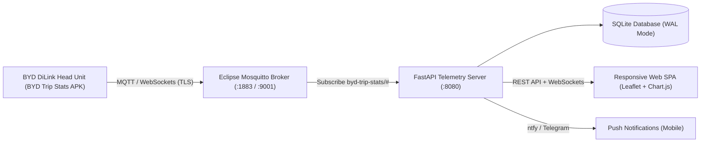

# BYD Telemetry & Live Dashboard

[](LICENSE)
[](https://fastapi.tiangolo.com)
[](https://docs.docker.com/compose/)
[](https://mosquitto.org)

An open-source, 100% self-hosted real-time telemetry server and responsive web dashboard for **BYD electric vehicles** (Atto 3, Seal, Dolphin, etc. equipped with DiLink head units).

Ingests live vehicle telemetry over MQTT from the in-car [BYD Trip Stats](https://github.com/angoikon/byd-trip-stats) app, automatically segments drives into trips, computes energy efficiency, and renders live maps, detailed elevation/speed charts, and charging statistics.

---

## 🌟 Key Features

- 🗺️ **Live Map & Telemetry:** Real-time car location tracking, speed, power flow (kW), battery SoC (%), temperature, and gear status.
- 🚗 **Autonomous Trip Logging:** Automatically detects trip start (drive/reverse) and finalizes trips with distance, duration, average speed, energy consumed (kWh), and efficiency (Wh/km).
- 📈 **Interactive Trip Profiler:** Route playback with Leaflet maps, color-coded speed/power segments, elevation profiles, and sensor graphs powered by Chart.js.
- ⚡ **Charging Session Tracking:** Logs charging events, power curves, energy added, and battery levels.
- 📱 **Mobile-First & PWA-Ready:** Optimized dark mode SPA designed for smartphones (with bottom navigation bar) and desktops.
- 🔔 **Instant Push Notifications:** Integration with free [ntfy.sh](https://ntfy.sh) and Telegram bots for instant notifications on trip start, trip end, or battery alerts.
- 📥 **Data Export:** Export any completed trip as **GPX** (for Strava / Google Earth) or **CSV**.
- 🔒 **100% Private & Self-Hosted:** No cloud subscriptions, no proprietary vendor lock-in. Your location and car data never leave your own server.

---

## 🏗️ Architecture



---

## 🚀 Quickstart

### Prerequisites
- [Docker](https://docs.docker.com/get-docker/) & [Docker Compose](https://docs.docker.com/compose/install/)

### 1. Clone & Configure
```bash
git clone https://github.com/your-username/byd-telemetry.git
cd byd-telemetry

# Copy example environment configuration
cp .env.example .env
```

Review `.env` and set your preferred passwords and ports:
```bash
MQTT_USER=byd
MQTT_PASS=change-this-secure-password
WEB_PORT=8080
```

### 2. Generate MQTT Password
Create the initial Mosquitto password file with your chosen password:
```bash
docker run --rm -v $(pwd)/mosquitto/config:/mosquitto/config eclipse-mosquitto:2 \
  mosquitto_passwd -c -b /mosquitto/config/pwfile byd change-this-secure-password
```

### 3. Launch Stack
```bash
docker compose up -d
```

Open your browser to:
👉 **`http://localhost:8080`**

---

## 🚗 In-Car Setup (BYD DiLink)

This telemetry server works seamlessly with the open-source in-car **BYD Trip Stats** app:

1. **Download the APK:**
   Run `./car-apks/download_apk.sh` or download the latest signed `byd-trip-stats.apk` release from [angoikon/byd-trip-stats/releases](https://github.com/angoikon/byd-trip-stats/releases).
2. **Install on Car:**
   - **Via USB:** Copy `byd-trip-stats.apk` onto a FAT32 USB drive, plug into the car's front data port, and install via File Manager.
   - **Via Wi-Fi / ADB:** Run `./car-apks/wireless_adb_install.sh <CAR_IP_ADDRESS>`.
3. **Permissions:**
   Open **BYD Trip Stats** on the car screen, select your vehicle model, and grant the ADB / USB debugging permission when prompted.
4. **Disable Autostart Killer:**
   Open the car's built-in **Disable Autostart** app and toggle BYD Trip Stats **OFF** so Android keeps it running in the background.
5. **Configure MQTT Connection (`Settings → Connections → MQTT`):**
   - **Enable MQTT:** `ON`
   - **Broker URL:** IP or Tailscale domain of your server
   - **Port:** `1883` (or `443` if using WSS via reverse proxy)
   - **Username:** value from `.env` (`byd`)
   - **Password:** value from `.env` (`change-this-secure-password`)
   - Tap **Test & Save**!

---

## 🌐 Remote Access via Tailscale (Zero Port Forwarding)

You can easily and securely connect your car to your server across 4G cellular without opening firewall ports:

1. Install [Tailscale](https://tailscale.com) on your host server.
2. Expose the MQTT WebSocket endpoint publicly for the car via **Tailscale Funnel**:
   ```bash
   tailscale funnel --bg --set-path /mqtt http://localhost:9001
   ```
3. Expose the web dashboard privately to your devices:
   ```bash
   tailscale serve --bg 8080
   ```
4. In the car's app, connect to `<your-machine>.<your-tailnet>.ts.net`, port `443`, with **TLS** and **WebSocket** enabled at path `/mqtt`.

---

## 🧪 Testing with the Kathmandu Drive Simulator

Don't have your car nearby? You can simulate a drive across Kathmandu Valley to test the dashboard, live telemetry, and trip analysis:

```bash
# Install dependencies
pip install paho-mqtt

# Run the drive simulation
python3 byd-telemetry/simulate_kathmandu_trip.py
```

Watch the dashboard update in real-time as the vehicle travels across the map!

---

## 🤝 Contributing

Contributions, issues, and feature requests are welcome! Feel free to check the [issues page](../../issues).
See [CONTRIBUTING.md](CONTRIBUTING.md) for testing guidelines and development tips.

---

## 📄 License & Credits

- Licensed under the [MIT License](LICENSE).
- In-car telemetry provider powered by the [byd-trip-stats](https://github.com/angoikon/byd-trip-stats) project by angoikon.
