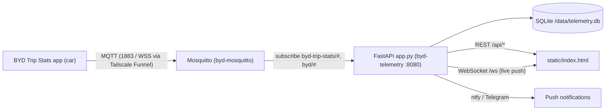

# AGENTS.md — BYD Atto 3 Telemetry Dashboard

Guide for humans and AI agents developing the telemetry website in this folder.
It's a self-hosted dashboard that ingests live MQTT telemetry from a BYD Atto 3
(via the **BYD Trip Stats** Android app running on the car's DiLink head unit), detects
trips, and renders a live map, trip history, mileage and charging stats.

> [!IMPORTANT]
> This is a **production** service running on the home-server MacBook. Real trips
> are recorded 24/7 into `../byd-data/telemetry.db`. Treat the database as
> irreplaceable, and avoid restarts while a trip is in progress (see [Deploying](#deploying)).

---

## 1. Architecture



| Piece | Location | Notes |
|---|---|---|
| Backend | [`app.py`](app.py) | Single-file FastAPI + paho-mqtt + sqlite3 (~1.8k lines). No ORM. |
| Frontend | [`static/index.html`](static/index.html) | Single-file SPA: inline `<style>` + inline `<script>`, vanilla JS. No build step. |
| Vendored libs | [`static/vendor/`](static/vendor/) | Leaflet, Chart.js, a **pre-compiled Tailwind snapshot**, Leaflet marker images. |
| Compose stack | [`../docker-compose.yml`](../docker-compose.yml) | `mosquitto`, `byd-telemetry`, `portainer`. |
| Data | `../byd-data/` → `/data` in container | `telemetry.db` (SQLite, WAL mode). |
| Tests | [`tests/`](tests/), [`run_e2e_tests.sh`](run_e2e_tests.sh), [`Dockerfile.test`](Dockerfile.test) | MQTT→DB→API pipeline tests + Playwright UI tests. |
| Simulator | [`simulate_kathmandu_trip.py`](simulate_kathmandu_trip.py) | Publishes a realistic Kathmandu drive over MQTT. |

### Backend at a glance (`app.py`)

- **Config** via env vars: `DB_PATH`, `MQTT_HOST`, `MQTT_PORT`, `MQTT_USER`, `MQTT_PASS` (set in compose).
- **Time zone:** everything is stored as epoch **milliseconds (UTC)**; "today / week / month" boundaries use `NPT` (UTC+05:45).
- **MQTT routing** (`on_mqtt_message`): topic `byd-trip-stats/<device>/<subtopic>`
  - `availability` → `vehicle_state.availability`
  - `trip` → `handle_trip_summary_message` (the app's own end-of-trip summary; reconciled with server-detected trips)
  - `charge_session` → `handle_charge_summary_message`
  - anything else (normally `state`) → `handle_state_message` (the hot path)
- **Trip lifecycle** (in `handle_state_message`):
  - Starts when gear is D/R or speed > 0.5 km/h. N keeps an active trip alive at stops.
  - Ends when car switches off or there's a > 5 min gap; `_finalize_trip` computes totals.
  - `_cleanup_stale_active_trips` (called from `/api/overview`) closes trips with no packets for > 5 min.
  - `_reconcile_trips_consistency` runs at startup to repair derived fields (e.g. `duration_s`).
  - Parked 30 s pings are merged with last-known values (`PERSISTENT_SENSOR_KEYS`) so awake-only sensors aren't wiped.
- **Concurrency:** MQTT callbacks run on paho's thread; all DB access is wrapped in `with db_lock:` and a fresh `get_db()` connection. WebSocket pushes go through `broadcast_ws`, which hops onto the asyncio `main_loop`.
- **Tables:** `vehicle_state` (single row, id=1), `trips`, `telemetry_points` (FK → trips, cascade), `charge_sessions`, `notification_settings`, `notifications`. Schema is created/migrated in `init_db()`.

### API

| Method | Path | Purpose |
|---|---|---|
| GET | `/` | Serves `static/index.html` (no-cache headers) |
| GET | `/api/overview` | Current state, active trip + route, mileage rollups, daily series, recent charges |
| GET | `/api/trips` | Trip list (query filters) |
| GET | `/api/trips/{id}` | Trip + all `points` |
| DELETE | `/api/trips/{id}` | Delete trip (cascades points) |
| GET | `/api/trips/{id}/export.gpx` · `.csv` | Exports |
| GET/POST | `/api/notifications`, `/api/notifications/settings`, `/api/notifications/test` | Push notification config + history |
| GET | `/apk`, `/apk/byd-trip-stats.apk` | Car APK download page |
| WS | `/ws` | Server → client push: `telemetry` (`state`, `trip_id`), `availability`, `notification`, `trip_completed` |

### Frontend at a glance (`static/index.html`)

- Tabs: **Live Map & Status**, **Mileage**, **Trips**, **Trip Detail** (`switchTab()`), plus a mobile bottom nav.
- Data flow: `refreshOverviewAndTrips()` on load + every 10 s; `connectWebSocket()` for live `telemetry` → `updateStateUI(state)`.
- Maps: `liveMap` (live car marker + route) and `detailMap` (speed/power-coloured route, start pin, live beacon or end pin, chart-hover marker).
- Live car marker: `makeCarIcon(heading, live)` + `updateLiveCarMarker()`. **Don't call `setIcon` on every tick.** It recreates the DOM and restarts CSS animations. Mutate the existing element instead.
- Charts: Chart.js instances are kept in globals and `destroy()`ed before re-creating.

---

## 2. Local development workflow

The compose service bind-mounts source files into the container:

```yaml
- ./byd-telemetry/app.py:/app/app.py
- ./byd-telemetry/static:/app/static
- ./byd-telemetry/tests:/app/tests
```

| You changed… | To see it |
|---|---|
| `static/**` (HTML/CSS/JS) | Just refresh the browser (`/` is served with no-cache). Bump `?v=N` on vendor asset URLs if you replace a vendor file. |
| `app.py` | `docker restart byd-telemetry` (uvicorn runs **without** `--reload`) |
| `Dockerfile` / Python deps | `cd ~/server && docker compose up -d --build byd-telemetry` |
| `docker-compose.yml` | `cd ~/server && docker compose up -d byd-telemetry` (recreates the container) |

Useful commands (run from `~/server`):

```bash
docker logs -f --tail 100 byd-telemetry          # app logs (MQTT connect, trip start/end, errors)
docker logs -f byd-mosquitto                      # broker logs
curl -s localhost:8080/api/overview | head -c 800 # quick API smoke test
curl -s localhost:8080/api/overview | grep -o '"active_trip":[^,]*'   # is a trip live right now?
docker exec -it byd-telemetry python3 -c "import sqlite3;c=sqlite3.connect('/data/telemetry.db');print(c.execute('select id,status,distance_km from trips order by id desc limit 5').fetchall())"
```

### Host machine quirks

- **No Xcode CLT** on this Mac: `python3`, `git`, `node` on the host trigger the xcode-select installer and fail. Run Python **inside the container** (`docker exec byd-telemetry python3 …`).
- `docker` is at `/usr/local/bin/docker` (OrbStack).
- Quick JS syntax check without Node (uses macOS JavaScriptCore):
  ```bash
  awk '/<script>$/{f=1;next} /<\/script>/{f=0} f' static/index.html > /tmp/check.js
  osascript -l JavaScript -e 'ObjC.import("Foundation"); var s=$.NSString.stringWithContentsOfFileEncodingError("/tmp/check.js",4,null).js; try{ new Function(s); "JS_OK" } catch(e){ "ERR: "+e }'
  ```
- Python syntax check: `docker exec byd-telemetry python3 -m py_compile /app/app.py`

### Generating test data

`simulate_kathmandu_trip.py` publishes a realistic drive. **It writes real rows into the production DB**, so delete the resulting trip afterwards (UI → Trip Detail → Delete, or `DELETE /api/trips/{id}`).

```bash
docker exec -e MQTT_HOST=mosquitto byd-telemetry python3 /app/simulate_kathmandu_trip.py
```

(The simulator lives at `/app/simulate_kathmandu_trip.py` from the image build. If you edit it, `docker cp` it in first.)

---

## 3. Testing

- `tests/test_e2e_pipeline.py`: publishes MQTT via `mock_stream_generator.py`, then asserts DB/API results (trips, distances, energy, exports).
- `tests/test_ui_e2e.py`: Playwright (Chromium) tests of the dashboard; screenshots → `/data/test-screenshots`.
- `run_e2e_tests.sh`: backs up `telemetry.db`, disables push notifications, runs both suites **inside the `byd-telemetry` container**, then restores the DB and clears retained MQTT messages on exit.

> [!WARNING]
> - The production image does **not** include `pytest`/`playwright`; those come from `Dockerfile.test` (Playwright base image). Install them in the container, or run the suites from a container built from `Dockerfile.test` on the same Docker network (`BASE_URL=http://byd-telemetry:8080`, `MQTT_HOST=mosquitto`).
> - The script **restores the DB backup when it exits**. Any real trip recorded while tests run is lost. Only run tests when the car is parked and `active_trip` is `null`.
> - The tests' `clear_all_trips()` wipes trips. Never point the suites at the live DB without the backup/restore wrapper.
> - The `docker cp` steps in the script are now redundant (files are bind-mounted) but harmless.

Minimum checks before declaring a change done:
1. Syntax checks (JS via `osascript`, Python via `py_compile`).
2. `curl` the affected endpoint(s) / load the page; check `docker logs` for tracebacks.
3. For trip-logic changes: run the pipeline tests (safely, per the warning above).

---

## 4. Deploying

There is no separate prod environment: **saving a file in `static/` is a deploy.**

1. Check no trip is active: `curl -s localhost:8080/api/overview | grep -o '"active_trip":[^,]*'` → `null`.
2. For backend changes: `docker restart byd-telemetry`, then watch `docker logs` for `Connected to Mosquitto` and `Application startup complete`.
3. Smoke test `/` and `/api/overview`.

If you must restart during a drive: MQTT `state` packets sent during the restart are lost. Trips survive via the `active` row and the 5 min gap rule, but you'll get a gap in the route.

Remote access: the dashboard is exposed through Tailscale (`tailscale serve` on 8080), and the car connects via Tailscale Funnel at `/mqtt` (→ Mosquitto WS 9001). See [`../README.md`](../README.md).

---

## 5. Best practices & conventions

### Data integrity
- **Back up before risky work:**
  `docker exec byd-telemetry python3 -c "import sqlite3;s=sqlite3.connect('/data/telemetry.db');d=sqlite3.connect('/data/telemetry.db.manual-$(date +%Y%m%d%H%M)');s.backup(d)"`
  (Use the SQLite backup API. Plain `cp` of a WAL-mode DB can produce a torn copy.)
- **Schema changes are additive only.** Add columns in `init_db()` via a guarded `ALTER TABLE … ADD COLUMN` (check `PRAGMA table_info` first). Never drop/rename columns or tables holding real data.
- Store timestamps as **UTC epoch ms**; convert to NPT only for display/rollups.
- Derived trip fields (`duration_s`, `distance_km`, `energy_kwh`, …) must stay consistent with raw data. If you change a formula, also update `_reconcile_trips_consistency` so historic rows are repaired at startup.
- MQTT retained messages are replayed on reconnect. Keep ingestion **idempotent** (see the duplicate-retained-packet guard in `handle_state_message`).

### Backend
- Every DB access: `with db_lock:` → `conn = get_db()` → `try/finally conn.close()`. Never hold `db_lock` while doing network I/O (push notifications use timeouts for this reason).
- Never block the MQTT callback thread for long; heavy work belongs in a background thread.
- Push to the UI via `broadcast_ws({...})`; keep message `type`s backward compatible with the frontend.
- Handle missing/zero sensor values defensively (`None`, `0`, lat ≈ 0). The car sends sparse payloads when parked.
- Keep secrets in env vars / compose, not hard-coded in new code.

### Frontend
- **Zero external CDNs.** The car/phone may be on flaky 4G + Tailscale, and CDN fetches broke the page before. Vendor any new library into `static/vendor/` and reference it with a `?v=N` cache-buster.
- **Tailwind is a frozen snapshot**, not a build. `tailwind-compiled.css` was captured from the Tailwind Play CDN output, so it **only contains classes that were in use at that time**. A new utility class (e.g. `bg-violet-500`, `gap-7`) silently does nothing. Either reuse classes already present (`grep -c 'class-name' static/vendor/tailwind-compiled.css`) or add custom CSS in the inline `<style>` block.
- Mobile-first: most use is on a phone. Check at ~375 px width, keep the bottom nav clearance (`pb-20`), and use `tabular-nums` for changing numbers.
- Escape any server/user-provided strings inserted via `innerHTML` with `escapeHtml()`.
- Respect `prefers-reduced-motion` for new animations.
- Leaflet: call `map.invalidateSize()` after a hidden tab becomes visible (see `switchTab`). Reuse markers/layers instead of recreating them per update.
- Chart.js: `destroy()` an existing chart before creating a new one on the same canvas.
- Keep all existing element IDs stable. The Playwright tests and JS select by ID.

### Process
- Make small, focused changes; preserve existing comments.
- After editing `index.html`, run the JS syntax check; after editing `app.py`, run `py_compile` **before** restarting (a syntax error takes the service down).
- There's no git on the host right now. Before a big refactor, snapshot the file: `cp static/index.html static/index.html.bak-$(date +%Y%m%d%H%M)` (and delete old snapshots later).
- Update this file when architecture, workflow or conventions change.
